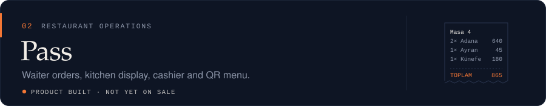

  <a href="https://github.com/esphi">github.com/esphi</a>
  &nbsp;·&nbsp;
  <a href="https://kesen.online">kesen.online</a>

 

<picture>
  <source media="(prefers-color-scheme: dark)" srcset="assets/bolum-01-koyu.svg">
  
</picture>

I study **Big Data Analytics** at Sakarya University of Applied Sciences (SUBÜ). Alongside the data work, I build software: mobile apps, web tools, AI-powered utilities and the occasional game.

Veri analizi okuyorum ama en çok sevdiğim şey bir fikri alıp gerçekten çalışan bir ürüne çevirmek. Bazen bu bir veri temizleme aracı oluyor, bazen bir restoran sistemi, bazen de her gün çözülen bir bulmaca.

 

<picture>
  <source media="(prefers-color-scheme: dark)" srcset="assets/bolum-02-koyu.svg">
  
</picture>

A daily number puzzle: arrange the numbers so every row, column and diagonal matches its target sum. 
Fikirden App Store incelemesine kadar getirdiğim ilk ürün; son rötuşlar sürüyor.

`JavaScript` `Supabase` &nbsp;·&nbsp; **Status:** iOS in App Store review, Android in closed testing &nbsp;·&nbsp; [kesen.online](https://kesen.online)

 

Restaurant operations in one system: waiters take orders on their phones, the kitchen sees them on screen, the cashier closes the bill and guests browse a QR menu. 
Ürün geliştirildi; satışa henüz başlanmadı.

`Flutter` `Dart` `Supabase` &nbsp;·&nbsp; **Status:** built, not yet on sale

 

Upload an Excel or CSV file: first a “ready for analysis?” report, then an automated dashboard. 
**Principle:** every number is computed by code, not by the AI. Yapay zekâ hangi grafiğin anlamlı olduğunu önerir; hesabı her zaman kod yapar.

`Python` `SQL` &nbsp;·&nbsp; **Status:** working project

 

Scores a dataset’s health, finds duplicate records, outliers and inconsistent spellings, then helps clean and standardize them. 
“Ahmet Yılmaz” ile “ahmet yilmaz ” aynı müşteri mi? Bu aracın işi tam olarak bunu yakalamak.

`Python` &nbsp;·&nbsp; **Status:** local version complete

 

A furniture store adds it to its own website; on a phone, the product appears in your room at real-world dimensions. 
Ducassi için bir demo hazır; geliştirme yeni başladı ve sürüyor.

`JavaScript` &nbsp;·&nbsp; **Status:** early development

 

A Turkish rap lyric-completion game with **Sansür Avcısı**, **Boss** and **Cypher** modes. 
Fikir sağlam ama eksikleri var; hâlâ deneme aşamasında.

`JavaScript` &nbsp;·&nbsp; **Status:** experimental, in development

 

<picture>
  <source media="(prefers-color-scheme: dark)" srcset="assets/bolum-03-koyu.svg">
  
</picture>

| Project | What it is | Built with |
|---|---|---|
| **ZIP RUSH** | Mobile puzzle game with classic, timed and endless modes; migrated from Unity to Flutter | Flutter |
| **Olta Diyarı** | Pixel-art fishing game; the Calm Lake section is playable | Godot |
| **Fossil Fusion** | Roblox game about excavation, dinosaur fusion and museum building; first successful Studio run | Roblox Studio |
| **Web Arena** | Browser-based 5v5 FPS experiment | JavaScript |
| **İHA Pilotu** | 3D browser flight simulation with TB2, Akıncı and Kızılelma | JavaScript |

 

<picture>
  <source media="(prefers-color-scheme: dark)" srcset="assets/bolum-04-koyu.svg">
  
</picture>

| Area | Tools |
|---|---|
| **Languages** | Python · SQL · JavaScript · TypeScript · Dart |
| **Web & mobile** | Next.js · React · Flutter |
| **Backend** | Supabase |
| **Games** | Godot · Unity |
| **Tools** | Git |

 

<picture>
  <source media="(prefers-color-scheme: dark)" srcset="assets/bolum-05-koyu.svg">
  
</picture>

- **Data analytics:** SQL ve Python ile gerçek veriden anlam çıkarmak.
- **Data cleaning:** dağınık Excel dosyalarını analize hazır hâle getirmek.
- **AI-powered applications:** with one rule, the model plans and the code calculates.
- **Product development:** bir prototipi mağazaya kadar götürmek.

 

<picture>
  <source media="(prefers-color-scheme: dark)" srcset="assets/bolum-06-koyu.svg">
  
</picture>

**GitHub:** [github.com/esphi](https://github.com/esphi) 
**KESEN:** [kesen.online](https://kesen.online)

 

