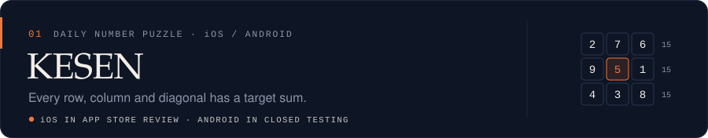
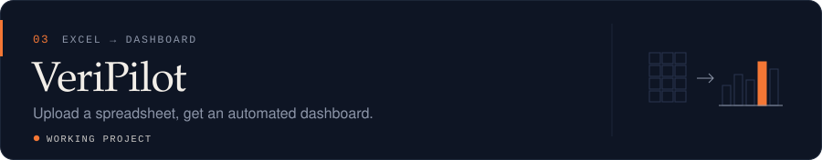
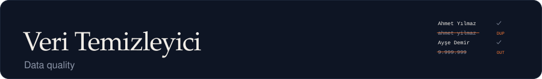
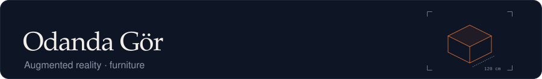
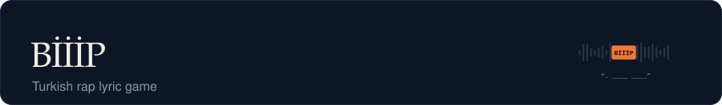

 

<picture>
  <source media="(prefers-color-scheme: dark)" srcset="assets/bolum-about-koyu.svg">
  
</picture>

I study **Big Data Analytics** at Sakarya University of Applied Sciences (SUBÜ). Alongside the data work, I build software end to end: a daily puzzle game, a restaurant system, data-cleaning tools and a few games along the way.

Veri analizi okuyorum ama en çok sevdiğim şey bir fikri alıp gerçekten çalışan bir ürüne çevirmek. Projelerimin kodu şimdilik gizli; aşağıda her birinin ne yaptığını ve hangi aşamada olduğunu olduğu gibi yazdım.

 

<picture>
  <source media="(prefers-color-scheme: dark)" srcset="assets/bolum-work-koyu.svg">
  
</picture>

A daily number puzzle: arrange the numbers so every row, column and diagonal matches its target sum. Fikirden App Store incelemesine kadar getirdiğim ilk ürün; son rötuşlar sürüyor.

**Status:** iOS in App Store review · Android in closed testing &nbsp;—&nbsp; `JavaScript` `Supabase` &nbsp;—&nbsp; [kesen.online](https://kesen.online)

 

Waiters take orders on their phones, the kitchen sees them on screen, the cashier closes the bill and guests browse a QR menu. Ürün geliştirildi; satışa henüz başlanmadı.

**Status:** built, not yet on sale &nbsp;—&nbsp; `Flutter` `Dart` `Supabase`

 

Upload an Excel or CSV file: first a “ready for analysis?” report, then an automated dashboard. Every number is computed by code, not by the AI. Yapay zekâ yalnızca hangi grafiğin anlamlı olduğunu önerir; hesabı her zaman kod yapar.

**Status:** working project &nbsp;—&nbsp; `Python` `SQL`

 

Scores a dataset’s health, finds duplicate records, outliers and inconsistent spellings, then helps clean and standardize them. “Ahmet Yılmaz” ile “ahmet yilmaz ” aynı müşteri mi? Bu aracın işi tam olarak bunu yakalamak.

**Status:** local version complete &nbsp;—&nbsp; `Python`

 

A furniture store adds it to its own website; on a phone, the product appears in your room at real-world dimensions. Ducassi için bir demo hazır; geliştirme yeni başladı ve sürüyor.

**Status:** early development &nbsp;—&nbsp; `JavaScript`

 

A Turkish rap lyric-completion game with Sansür Avcısı, Boss and Cypher modes. Fikir sağlam ama eksikleri var; hâlâ deneme aşamasında.

**Status:** experimental, in development &nbsp;—&nbsp; `JavaScript`

 

<picture>
  <source media="(prefers-color-scheme: dark)" srcset="assets/bolum-experiments-koyu.svg">
  
</picture>

| Project | What it is |
|---|---|
| **ZIP RUSH** | Mobile puzzle game with classic, timed and endless modes; migrated from Unity to Flutter |
| **Olta Diyarı** | Pixel-art fishing game in Godot; the Calm Lake section is playable |
| **Fossil Fusion** | Roblox game about excavation, dinosaur fusion and museum building; first successful Studio run |
| **Web Arena** | Browser-based 5v5 FPS experiment |
| **İHA Pilotu** | 3D browser flight simulation with TB2, Akıncı and Kızılelma |

 

<picture>
  <source media="(prefers-color-scheme: dark)" srcset="assets/bolum-stack-koyu.svg">
  
</picture>

**Languages** &nbsp; Python · SQL · JavaScript · TypeScript · Dart 
**Frameworks & tools** &nbsp; Next.js · React · Flutter · Supabase · Git 
**Games** &nbsp; Godot · Unity

 

<picture>
  <source media="(prefers-color-scheme: dark)" srcset="assets/bolum-now-koyu.svg">
  
</picture>

- **Shipping KESEN:** App Store incelemesi ve Android kapalı testi sürerken son rötuşlar.
- **Data tooling:** Veri Temizleyici ve VeriPilot ile dağınık Excel dosyalarından güvenilir rapora.
- **AI with guardrails:** model planlar, hesabı kod yapar.
- **Odanda Gör:** Ducassi demosundan ilk sürüme.

 

