<picture>
  <source media="(prefers-color-scheme: dark)" srcset="assets/kapak-koyu.svg">
  
</picture>

Sakarya Uygulamalı Bilimler Üniversitesi'nde Büyük Veri Analistliği okuyorum. Şubat 2027'de başlayacak işletmede mesleki eğitim (İME) için veri analizi alanında yer arıyorum.

Yaptığım işlerde bir kuralım var: **sayıyı yapay zekâ değil, kod hesaplar.** Dil modeli yalnızca planı çıkarır; toplamı, ortalamayı, aykırı değeri SQL ve pandas bulur.

### Projeler

**[KESEN](https://kesen.online)** — Günlük sayı bulmacası: satır, sütun ve köşegen toplamlarını hedefe eşitle. JavaScript, Capacitor ve Supabase ile yazıldı; iOS ve Android için.

Yeni projeler bittikçe buraya ekliyorum.

### Kullandıklarım

Python · pandas · SQL (PostgreSQL, DuckDB) · Streamlit · FastAPI · Flutter · JavaScript · Supabase · Git
