I study **Big Data Analytics** at SUBÜ and build software end to end: data tools, mobile apps, games. Kodlarım şimdilik gizli; her projenin nerede durduğu aşağıda. En yakını [KESEN](https://kesen.online), App Store incelemesinde.

